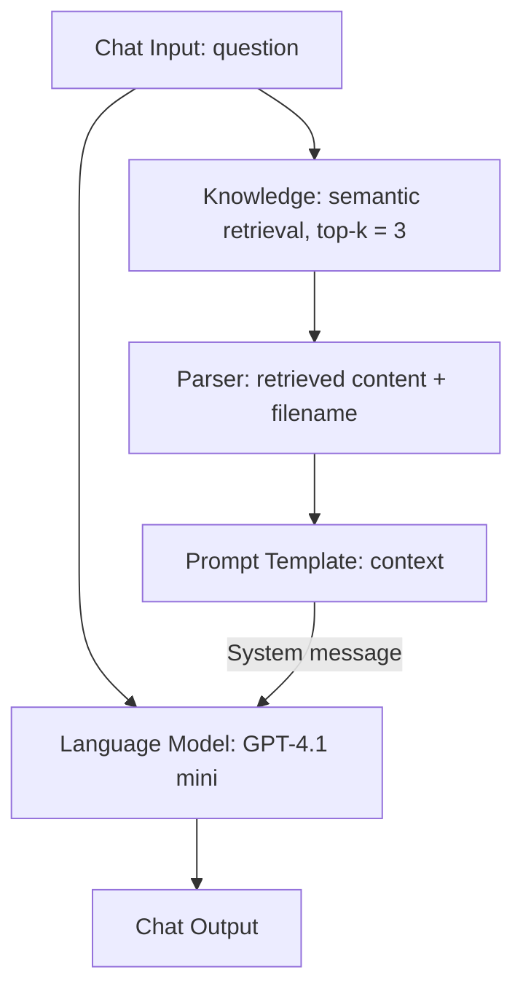
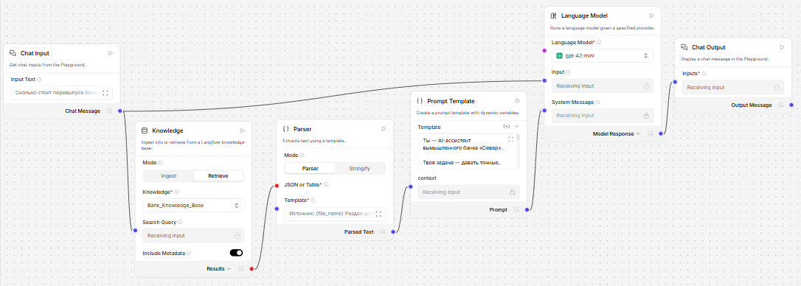

# Bank RAG Assistant — Langflow A/B Prompt Evaluation

A **local educational Retrieval-Augmented Generation (RAG) prototype** for a **fictional bank**, built in **Langflow 1.13**. It retrieves passages from a synthetic Russian-language bank regulation and uses an LLM to produce grounded answers with document section references.

> **Portfolio scope:** learning/demo project, not deployed to a bank or tested on real customer data. The financial products, institution and policies in the source document are fictional.

## Outcome

Two prompt versions were evaluated manually using **25 questions each** (50 model responses). The rubric includes four binary dimensions per answer: factual accuracy, completeness, no unsupported claims, and appropriate source section reference.

| Metric | Prompt A | Prompt B |
|---|---:|---:|
| Factual accuracy | 25/25 | 25/25 |
| Completeness | 24/25 | 25/25 |
| No unsupported claims | 25/25 | 25/25 |
| Source reference | 23/25 | 23/25 |
| **Total** | **97/100** | **98/100** |

**Interpretation:** Prompt B scored **one point higher** on this small hand-curated dataset, primarily through a more complete answer. This is **not** a statistically established advantage or a production performance benchmark. The evaluation used one run per question per prompt, without repeated trials, independent annotation or a retrieval-specific recall metric.

## Architecture

### Langflow workflow

The underlying knowledge base was created with **OpenAI `text-embedding-3-small`**, `chunk_size = 500 characters`, `chunk_overlap = 75 characters`, using the newline separator. This produced **6 chunks** from the synthetic document. The Knowledge component retrieves up to **3** passages for each query. The Parser formats their `content` and `file_name` fields into the `{context}` variable for the system prompt.

The input goes both to the retrieval step and the model. A model response is generated using the retrieved document context.

## Repository layout

- `flows/prompt_a.json` — original Langflow Flow export
- `flows/prompt_b.json` — updated Langflow Flow export
- `data/fictional_bank_rules_rag.txt` — synthetic Russian bank policy (no confidential information)
- `evaluation/ab_test_results.xlsx` — question set, model answers, hand scores and summary
- `screenshots/rag_architecture.png` — illustrative workflow screenshot taken during assembly; some components may be outside the screenshot frame

## How to reproduce locally

1. Install and run **Langflow 1.13** (or verify compatibility of a newer version).
2. Configure an OpenAI API key inside Langflow (**do not commit it**). API usage is billed separately from ChatGPT subscriptions.
3. Create a Knowledge Base named `Bank_Knowledge_Base` with embedding model `text-embedding-3-small` and upload `data/fictional_bank_rules_rag.txt`. For the source chunking, use 500 characters, 75-character overlap, and newline separator. The stored Knowledge Base **is not embedded in the Flow JSON exports**.
4. Import `flows/prompt_a.json` and `flows/prompt_b.json` into Langflow. Inspect their Knowledge selections; reselect `Bank_Knowledge_Base` if necessary. Also verify model and API credentials are configured locally.
5. Open Playground for each flow and send the same test questions. Use separate fresh conversations and keep model/retrieval settings identical for a fair comparison.
6. Review the answers and fill out the scoring sheet using the four rubric dimensions. Scores in the provided workbook are **previously recorded manual scores**, not automatically generated by the code in this repository.

> The exports preserve node configurations and connections but do not provision a running database, paid API credentials, or hosted endpoint. Reproducibility across new Langflow releases is not guaranteed.

## Example queries

- `Сколько стоит перевыпуск карты при утере?` — should return **390 RUB**, section **2.2**.
- `Какая процентная ставка по накопительному счёту?` — should explicitly state that the regulation does not specify a rate.
- `Сотрудник банка просит назвать CVV. Что делать?` — should say not to disclose codes and refer to official bank contact channels based on sections **4.1–4.2**.

## Limits and next improvements

- Only one short, synthetic document; production corpora have much greater diversity and complexity.
- No measured retrieval recall@k, groundedness via automated judge, latency distribution or token-cost tracking.
- Each question evaluated once; a stronger experiment would repeat calls and use blind assessment and independent held-out questions.
- Add prompt-injection tests against malicious retrieved documents, missing-source conditions, multi-document conflicts and access-control boundaries before any real-world deployment.
- Model outputs may vary, and source citations are **section labels inferred from the provided text**, not independently verified document links.

## Security

Exported flows were checked for OpenAI-style secret strings and the `api_key` fields examined were blank. **This does not replace a full secret scan before publishing.** Never commit `.env`, billing details, tokens, user data or local databases; use Langflow's credential management instead. If a credential is accidentally published, revoke and replace it.

## Technology

Langflow 1.13 · Python-based LLM components · GPT-4.1 mini · OpenAI Embeddings (`text-embedding-3-small`) · built-in Knowledge Base · semantic retrieval · prompt A/B testing
